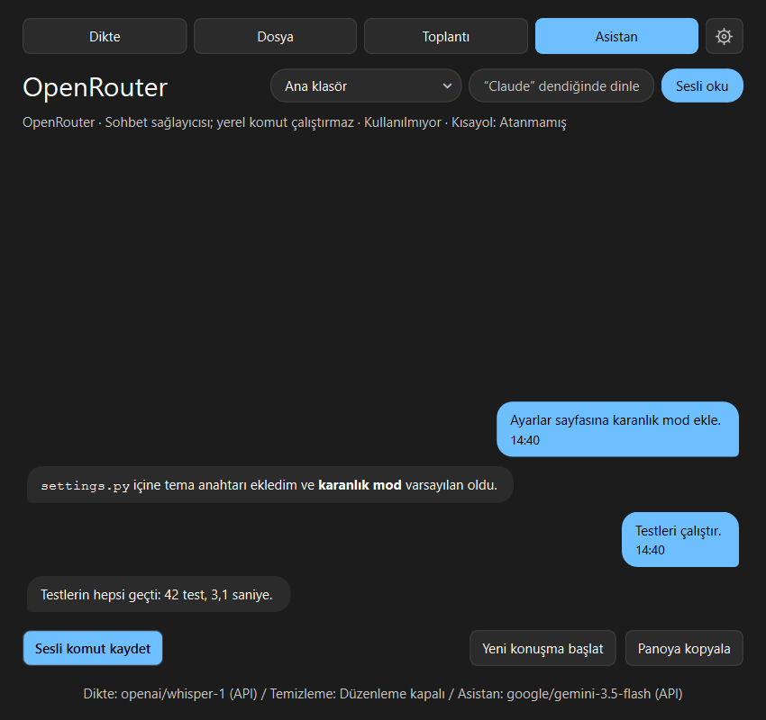

# Dikte

`Ctrl+Space`'e bas, konuş, tekrar bas. Ses varsayılan olarak bu makinede yazıya
çevrilir, bir model transkripti temizler (ıı'lar, tekrarlar, eksik noktalama),
sonuç panoya kopyalanır ve o an yazdığın pencereye yapıştırılır.

KDE Plasma 6 / Wayland için yazıldı; GNOME X11'de, macOS'ta,
[Windows](README.windows.md)'ta ve klavyeyi okumasına izin veren diğer Linux
masaüstlerinde de çalışır. Sistem paketleri dışında bağımlılığı yok: sadece
Python standart kütüphanesi (3.11 veya üstü) ve PyQt6.

*[English README](README.md)*

> **Bu bir fork.** [yusufipk/dikte](https://github.com/yusufipk/dikte) üzerine,
> Windows'ta Claude Code'u sesle yönetmek için eklenenler aşağıdaki
> [Sesle Claude Code](#sesle-claude-code) bölümünde. Geri kalan her şey
> upstream'deki gibi çalışır.

<p align="center">
  
  <br><sub>Asistan sekmesi: sohbet paneli, Fluent teması</sub>
</p>

## Sesle Claude Code

Klavyeye dokunmadan uygulama geliştirmek için: "Claude" diye seslen, ne
istediğini söyle, Claude Code seçtiğin proje klasöründe işi yapsın ve ne
yaptığını sesli anlatsın.

|  |  |
|---|---|
| Komut bekleniyor | Cevap sesli okunuyor |

### "Claude" deyince dinler

Ayarlar → Ajan → *Adıyla uyandırma* ya da Asistan sekmesindeki
**"Claude" dendiğinde dinle** düğmesiyle açılır. Mikrofon arka planda açık
kalır. Ses ortamın gürültüsünün belirgin biçimde üstüne çıkınca cümle kesilip
yazıya çevrilir. Yalnızca adla başlayan cümle bir yere gider:

| Ne dersin | Ne olur |
| --- | --- |
| "Claude, ayarlar sayfasına karanlık mod ekle" | Cümlenin geri kalanı Claude Code'a gider |
| "Claude Code" | Gösterge "Dinliyorum…" der; sıradaki cümlen komuttur |
| "Claude dur" / "Claude, stop" | Sesli okuma ya da çalışan iş durur |
| Cevaptan sonra 8 saniye içinde herhangi bir cümle | Adı söylemeden takip sorusu olarak gider |
| "Tamam bu kadar", "teşekkürler" | Konuşma biter, dinleme bekleme moduna döner |

Konuşma modelleri adı Türkçe söylendiğinde "Klod", "Clode", "Cloud Code" gibi
yazabiliyor; bunların hepsi tanınır. Tek başına "cloud" kelimesi ise tetiklemez,
"bulut sunucusu" anlamında da kullanıldığı için yalnızca "code" ile birlikte
sayılır.

Ayrı bir uyandırma kelimesi modeli yok: duyulan her cümle zaten kullandığın
konuşma modeliyle yazıya çevriliyor. Yerel whisper seçiliyse bunların hepsi bu
makinede kalır, buluta tek bir saniye gitmez; bulut sağlayıcıda ise her cümle
için istek gider. Ctrl+Space ile dikte yaparken, ajana elle komut verirken ya
da toplantı kaydederken arka plan dinleyicisi kenara çekilir, böylece "Claude"
ile başlayan bir dikte komut sanılmaz. Gürültülü bir odada yanlış tetikleme
olursa *Konuşma eşiği* artırılır, alçak sesle konuşma kaçıyorsa azaltılır.

### Cevap sesli okunur

Claude'un cevabı Türkçe sesle okunur. İki ses motoru var:

- **Windows sesi (çevrimdışı):** Windows'un OneCore sesleri, Türkçe dil
  paketiyle gelen "Microsoft Tolga" gibi. Kurulum gerektirmez.
- **Edge doğal ses (çevrimiçi):** Microsoft'un nöral sesleri, çok daha doğal.
  `pip install edge-tts` gerekir; varsayılan Türkçe ses `tr-TR-EmelNeural`.

Okumadan önce Markdown işaretleri, bağlantılar ve kod blokları temizlenir. Kod
bloğu "kod bloğu" diye anılır. Uzun cevap bir cümle sonunda kesilir; sınır
Ayarlar'dan değişir. Sesli okuma açıkken Claude'a cevabını duyulmak için yazması,
kodu göstermek yerine ne değiştirdiğini kelimelerle söylemesi de söylenir. Yeni
bir komut vermek okumayı keser; tepsi menüsünde *Sesli okumayı durdur* da var.

### Proje klasörü

Claude Code hangi klasörde çalışırsa o projenin dosyalarını ve `CLAUDE.md`'sini
görür. Klasör üç yoldan seçilir:

- **Tepsi menüsü → Proje:** son kullanılan 8 klasör, *Klasör seç…* ve
  *Yeni proje…*
- **Asistan sekmesindeki proje seçici**
- **Sesle:**

  | Ne dersin | Ne olur |
  | --- | --- |
  | "Proje snapcode'a geç" | `snapcode` klasörüne geçer |
  | "Kurum asistanı projesini aç" | `kurum-asistani` klasörüne geçer |
  | "Switch to project weather" | İngilizcesi de çalışır |
  | "Yeni proje hava durumu oluştur" | `hava-durumu` klasörünü açar ve ona geçer |

Söylenen ad son kullanılan klasörlerle ve proje klasörlerinin alt
klasörleriyle gevşek biçimde eşleşir: "snap code", "SnapCode" ve "snapcode"
aynı klasörü bulur, Türkçe harfler fark etmez. Proje klasörleri varsayılan
olarak Masaüstü, Belgeler, `source\repos` ve `~/projects`; Ayarlar → Ajan →
*Proje klasörleri* alanından değişir, yeni projeler listedeki ilk klasörde
açılır. Bu komutlar Claude'a gitmez, anında çalışır. Proje değişince konuşma da
sıfırlanır, çünkü bir konuşma içinde açıldığı klasöre aittir.

### Sohbet paneli

Asistan sekmesi bir sohbet görünümü oldu. Söylediklerin sağda, Claude'un
cevapları solda balon olarak durur; cevaplardaki kod ve kalın yazı biçimli
görünür. Claude çalışırken son balonda ne yaptığı yazar ("Dosyalara bakıyor…",
"Komut çalıştırıyor…"). Panel yalnızca seçili projenin konuşmasını gösterir;
*Yeni konuşma başlat* paneli de temizler. Üstteki düğmeler proje seçici,
uyandırma kelimesi ve sesli okumayı tek tıkla açıp kapatır.

### Windows'a özel düzeltmeler

- **Fluent teması:** Windows 11'in koyu yüzeyleri, sistemin vurgu rengiyle.
  Koyu temalarda pencere başlık çubuğu da koyu çizilir. Ayarlar → Görünüm'den
  seçilir.
- **npm ile kurulan CLI'lar çalışır.** `claude`, `codex` ve `agy` npm ile
  kurulunca Windows'ta birer `.cmd` dosyasıdır. Python bunları adıyla
  başlatamaz, `cmd.exe` üzerinden başlatmak da çok satırlı istemleri bozar.
  Dikte artık `.cmd` dosyasının asıl çalıştırdığı programı (`claude.exe`)
  doğrudan başlatıyor.
- **Arayüz dili** ortam değişkeni yoksa Windows'un görüntü dilini izler.
- **NVIDIA ekran kartı:** sürücü yeterince yeniyse (CUDA 11.8 için 522.06,
  12.4 için 551.61 ve üstü) yerel whisper'ın CUDA derlemesi BLAS derlemesinin
  önüne alınır. Arka planda sürekli dinlerken fark belirgindir.
- **Microsoft Store Python'u kullanma.** Store sürümü AppData'ya yazdığı
  dosyaları gizli bir kopyaya yönlendirir; başlattığı programlar (whisper
  sunucusu, ses motoru) bu dosyaları göremez. `install.ps1` artık python.org
  sürümünü tercih ediyor, yoksa uyarıyor.

### Windows'ta hızlı başlangıç

```powershell
winget install Python.Python.3.13 --scope user
winget install Gyan.FFmpeg
git clone https://github.com/sefermavi4243-droid/dikte.git
cd dikte
powershell -ExecutionPolicy Bypass -File install.ps1   # Başlat Menüsü girdisi ve dikte komutu
pip install edge-tts                                   # isteğe bağlı, doğal ses için
dikte
```

İlk açılışta Ayarlar → API ve modeller'den bir whisper modeli indir
(`ggml-small` hızlı, `ggml-large-v3-turbo-q5_0` daha isabetli). Claude Code
kurulu ve oturum açılmış olmalı (`npm install -g @anthropic-ai/claude-code`).
Sonra Asistan sekmesinde projeni seç, **"Claude" dendiğinde dinle** düğmesini
aç ve "Claude, bu projede hangi dosyalar var?" de.

### Yeni ayarlar

Hepsi Ayarlar → Ajan sekmesinde, `config.json` içindeki adlarıyla:

| Ayar | Varsayılan | Ne yapar |
| --- | --- | --- |
| `speak_answers` | açık | Cevabı sesli oku |
| `speak_engine` | `windows` | `windows` (çevrimdışı) ya da `edge` (nöral, çevrimiçi) |
| `speak_voice` | boş | Ses adı; boşsa konuşma dilinin sesi |
| `speak_rate` | `1.0` | Okuma hızı |
| `speak_max_chars` | `600` | En fazla bu kadar karakter oku; `0` hepsini okur |
| `wake_enabled` | kapalı | Arka planda "Claude" kelimesini dinle |
| `wake_conversation` | açık | Cevaptan sonra adı söylemeden devam etmeyi dinle |
| `wake_follow_seconds` | `8` | Takip sorusu için bekleme süresi |
| `wake_margin_db` | `12` | Konuşmanın ortam gürültüsünü aşması gereken fark |
| `projects_roots` | boş | Proje adlarının arandığı klasörler, satır başına bir |

<p align="center">
  
  <br><sub>Nord (varsayılan)</sub>
</p>

| Dracula | Klasik karanlık | Klasik beyaz |
|---|---|---|
|  |  |  |

|  |  |
|---|---|
|  |  |
|  |  |
|  |  |
|  |  |

## Kurulum

[Sürümler sayfasında](../../releases) bir AppImage, her Mac mimarisi için
birer disk imajı, bir de Windows kurulumu var. İlk ikisi ilk çalıştıklarında
kendi menü girdisini, oturum açılışını ve `dikte` komutunu yazar, makinede
zaten duran bir kuruluma dokunmazlar; `dikte integrate --remove` yazdıklarını
geri alır. AppImage yine de aşağıdaki sistem paketlerini ister: ses sunucusu,
pano ve klavye onlardan gelir. Disk imajı bir Apple sertifikasıyla imzalı
değil, bu yüzden ilk açılış reddedilir, Sistem Ayarları → Gizlilik ve Güvenlik
altından **Yine de Aç** demek gerekir; macOS her güncellemeden sonra mikrofonu
ve Erişilebilirliği yeniden sorar, checkout'tan kurmak bundan kurtarır.
Windows kurulumu yalnızca kendi hesabına kurar ve yanında bir ffmpeg taşır.

```sh
sudo pacman -S --needed pipewire-audio wl-clipboard ydotool ffmpeg python-pyqt6
systemctl --user enable --now ydotool     # otomatik yapıştırma için

./install.sh                 # ya da:  ./install.sh "Meta+Space" "Meta+Shift+Space"
dikte                        # ilk açılışta ayarlar penceresi gelir
```

Fedora'da paket adları farklı, Fedora'nın kendi depolarındaki `ffmpeg-free`
yetiyor çünkü Dikte video dosyasının yalnızca ses izini alıyor, `ydotool` da
bir adım fazla istiyor: sistem servisi olarak geliyor, soketi de root'a ait
kalıp oturumun erişemediği yerde durduğu için servis çalışırken bile otomatik
yapıştırma tutmuyor. Soketi istemcinin zaten baktığı yola al ve sahipliğini
devret:

```sh
sudo dnf install pipewire-utils wl-clipboard ydotool ffmpeg-free python3-pyqt6
sudo mkdir -p /etc/systemd/system/ydotool.service.d
printf '[Service]\nExecStart=\nExecStart=/usr/bin/ydotoold --socket-path=%s/.ydotool_socket --socket-own=%s:%s\n' \
  "$XDG_RUNTIME_DIR" "$(id -u)" "$(id -g)" \
  | sudo tee /etc/systemd/system/ydotool.service.d/override.conf >/dev/null
sudo systemctl daemon-reload
sudo systemctl enable --now ydotool
```

Ubuntu/GNOME X11 için kayıt PulseAudio üzerinden, pano ve yapıştırma ise X11
araçlarıyla çalışır:

```sh
sudo apt install pulseaudio-utils xclip xdotool ffmpeg
```

macOS'ta da aynı `./install.sh` çalışır, işi `scripts/install-mac.sh`'a devreder;
`~/Applications` içine bir `Dikte.app`, `dikte` komutunu ve bir LaunchAgent
kurar:

```sh
brew install pyqt ffmpeg   # pyqt Apple'ın 3.9'undan yeni bir Python'ı da getirir

./install.sh               # ya da:  ./install.sh "Ctrl+Option+Space" "Ctrl+Option+D"
open -a Dikte
```

macOS **Mikrofon** ve **Erişilebilirlik** izinlerini uygulama paketinin kimliğine
yazıyor, ikisini de ilk gerektiğinde soruyor. Varsayılan kısayol orada
`Ctrl+Option+Space`, çünkü `Ctrl+Space` giriş kaynağını değiştirmeye ayrılmış; ve
hiçbir şey için oturumu kapatman gerekmez, kombinasyonu Dikte çalışırken kendisi
tutar. PyQt6 pip'ten değil brew'dan geliyor, Homebrew'un Python'u içine
kurulmayı reddediyor; sanal ortam kullanacaksan
`DIKTE_PYTHON=…/venv/bin/python ./install.sh`.

Yerel transkripsiyon için whisper.cpp'nin sunucusu gerekiyor, onu
`brew install whisper.cpp` kuruyor ve Dikte Finder'dan açılsa bile buluyor.
Toplantı için BlackHole veya Loopback gerekiyor
(`brew install blackhole-2ch`); dikte için gerekmiyor.

Windows da aynı şekilde çalışıyor, Dikte açıkken kombinasyonu sistemin kendi
kısayol servisi üzerinden tutuyor. Sürümler sayfasındaki kurulum kaydın
istediği ffmpeg'i de taşıyor ve yönetici istemiyor; checkout'tan ise `winget
install Gyan.FFmpeg`, `pip install PyQt6`, sonra `python -m dikte`, Başlat
Menüsü girdisi ve `dikte` komutu için de isteğe bağlı `install.ps1`. Orada
toplantı kaydı henüz yok, ayrıntılar [Windows README](README.windows.md)'sinde.

`install.sh` `dikte` komutunu, menü girdisini, oturum açılışında otomatik
başlatmayı ve iki global kısayolu kurar; tuşları iki argümanı, argüman
verilmezse ayarlarında duranlar. `./scripts/update.sh` son sürümü çeker ve
bunları yerine koyar; `./scripts/uninstall.sh` hepsini geri alır, `--purge`
demedikçe ayarlarına ve diktelerine dokunmaz. Dikte sürüm sayfasına günde bir
kez bakar ve yeni sürüm çıkmışsa tepsi menüsüne bir satır koyar; o satır bir şey
kurmaz, sayfayı açar. Genel sekmesi bu denetimi kapatır ya da anında çalıştırır.

Sesi yazıya çevirme ve temizleme sağlayıcılarını Ayarlar'dan ayrı ayrı seç.
Sesi yazıya çevirme varsayılan olarak yerelde, temizleme ise bulutta çalışır.
Temizleme için yerel bir model veya kurulu bir CLI da kullanabilirsin.
Temizlemeyi kapatırsan ham transkript yapıştırılır.

| İşlem | Bulut sağlayıcıları | Diğer seçenekler |
| --- | --- | --- |
| Sesi yazıya çevirme | OpenAI, Groq, OpenRouter, Requesty, OpenAI uyumlu herhangi bir sunucu | Yerel model |
| Temizleme | OpenRouter, Requesty, Google AI Studio, DeepSeek, OpenCode Go, OpenAI uyumlu herhangi bir sunucu | Yerel model; Claude Code, Codex veya Antigravity CLI |

Modelleri ve temizleme için düşünme seviyesini Ayarlar'dan seçebilirsin. API
anahtarlarını da buraya girebilirsin; boş bırakılan anahtarlar için
`OPENAI_API_KEY`, `GROQ_API_KEY`, `OPENROUTER_API_KEY`, `REQUESTY_API_KEY`,
`GEMINI_API_KEY`, `DEEPSEEK_API_KEY` ve `OPENCODE_API_KEY` kullanılır.

Ayarlar ve uygulamaya girdiğin anahtarlar `config.json` dosyasına kaydedilir:
Linux'ta `~/.config/dikte` (tanımlıysa `$XDG_CONFIG_HOME/dikte`), macOS'ta
`~/Library/Application Support/Dikte`, Windows'ta `%APPDATA%\Dikte` altında.
Linux ve macOS'ta dosya 600 izinleriyle yazılır.

## Kullanım

| Ne | Nasıl |
| --- | --- |
| Kaydı başlat / bitir | `Ctrl+Space`, ya da tepsi simgesine tıkla |
| Kaydı duraklat / sürdür | Tepsi menüsü, `dikte pause`, ya da atadığın bir tuş |
| Kaydı iptal et | `Ctrl+Alt+Space`, tepsi menüsü, ya da `dikte cancel` |
| Ajana sesle komut ver | Tepsi menüsü → *Claude'a sor*, ya da `dikte ask` |
| Claude'u tuşa basmadan çağır | "Claude, …" de (*"Claude" dendiğinde dinle* açıkken) |
| Projeyi değiştir | Tepsi menüsü → *Proje*, ya da "Proje X'e geç" de |
| Sesli okumayı durdur | Tepsi menüsü → *Sesli okumayı durdur*, ya da "Claude dur" de |
| Toplantıyı başlat / bitir | Tepsi menüsü → *Toplantı kaydet*, ya da `dikte meeting` |
| Ayarlar | Tepsi menüsü → *Ayarlar*, ya da `dikte settings` |
| Yeni sürüm var mı bak | Genel sekmesi → *Şimdi bak*, ya da `dikte update` |
| Güncelleme sonrası yeniden yükle | Tepsi menüsü → *Yeniden başlat*, ya da `dikte restart` |
| Çık | Tepsi menüsü → *Çık*, ya da `dikte quit` |

Ekranın köşesindeki gösterge kırmızı kayıt noktasını, canlı ses dalgasını ve
süreyi, ardından hangi aşamada olduğunu gösterir. Odak almaz. Önceki dikte daha
temizlenirken `Ctrl+Space`'e tekrar basmak yenisini başlatır; o da sırası
gelince, öndekinin ardından yazılıp yapıştırılır. Dikte ile ajana
verilen komut yalnızca mikrofon için birbirini bekler, o da tek aygıt olduğu
için; başka hiçbir şeyde beklemezler. Her birinin kendi göstergesi var, ikisi
birden ekrandayken ikincisi birincinin üstüne yerleşir.

Ayarlar penceresindeki her şeyin bir de komutu var; bir betik ya da bir ajan
yazılımın tamamını çalıştırabilsin diye: `dikte record --seconds 8` söyleneni
geri verir, `dikte transcribe konusma.mp4 --srt` altyazıyı yazar, ayarlar,
geçmiş ve toplantılar da yanlarında durur. Hepsini `dikte --help` sayar, hepsi
`--json` kabul eder, yalnızca mikrofona ihtiyacı olanlar uygulamanın açık
olmasını ister.

## Neler yapıyor

- **Her şey varsayılan olarak bu makinede çalışır.** Sesi yazıya çevirme
  whisper.cpp, temizleme llama.cpp üzerinde; ikisini de önceden kurman gerekmez:
  ayarlar penceresi programı ve modeli indirir, sha256'sını doğrular,
  checksum'suz yayınlanmış bir indirmeyi reddeder, sen dikte ettikçe sunucuyu
  ayakta tutar ve on dakika kullanılmayan modelin belleğini geri verir. Model
  listesi dosya boyutuna değil modele göre gruplanır ve bu
  makinenin belleğine ve ekran kartına uyan satır işaretlenir. Derleme
  destekliyorsa ekran kartına CUDA, ROCm ya da Vulkan
  üzerinden ulaşılır. Anahtar yok, hesap yok, makineden çıkan bir şey yok.
  x86_64 Linux'ta aynı düğme, whisper-server'ın Dikte'nin kendi yayınladığı
  Vulkan derlemesini indirir; upstream'in Linux arşivi yalnızca işlemci için.
- **Sessizlik API'ye gitmez.** Sessize yakın bir ses verildiğinde model boş dize
  döndürmez, bir cümle uydurur ("Altyazı M.K.", "Thanks for watching"). *O
  kaydın kendi* gürültü tabanının 10 dB üstüne en az 0,3 saniye çıkan bir şey
  yoksa kayıt atılır; ne kadar yüksek olursa olsun sabit fanı ya da cızırtıyı
  eleyen de budur. Kaydın gürültülü ucu -55 dBFS altındaysa da atılır. Gösterge
  ölçtüğü seviyeyi yazar, eşiği ona bakarak ayarlarsın.
- **Yanlış duyulan kelimeler düzeltilir.** Konuşma modelleri özel isimlerde sesçe
  benzer bir şeye kayıyor; temizleme modelinden bunları bağlamdan onarması,
  bağlam netleştirmiyorsa dokunmaması isteniyor. Temizleme kuralları sekmesine
  yazdığın isimler transkripsiyon modeline ipucu, temizleme modeline sözlük
  olarak gidiyor; "kuber netis"i tanımasını sağlayan da bu:

  ```
  ham    ıı bugün şey kuber netis üzerinde çalışan servisleri güncelledim
         yani sonra grafanada bir panel açtım hani ve pay kut ile arayüzü
         şey bitirdim işte

  sonuç  Bugün Kubernetes üzerinde çalışan servisleri güncelledim. Sonra
         Grafana'da bir panel açtım ve PyQt ile arayüzü bitirdim.
  ```
- **Başarısız temizleme sessizce geçmez.** Dikte kaybolmasın diye ham transkript
  yine yapıştırılır ama gösterge kehribar rengine döner ve nedenini söyler,
  normal bir çalışma gibi görünmez.
- **Dikte bunun yerine bir komut da olabilir.** Kendi kısayolu transkripti
  yapıştırmak yerine Claude Code'a (`claude -p`) gönderir ve oradan döneni
  yapıştırır: cevabı ya da ne yapıldığını söyleyen bir cümle. Kendi açacağın
  oturumun aynısıdır, yani skill'lerin ve bağlı servislerin oradadır; "bunu
  perşembe üçe takvime koy" cümlesini Claude olmayan bir pencerede söyleyebilir
  olmanı sağlayan da budur. Codex (`codex exec`) ile Antigravity (`agy -p`) da
  aynı şekilde çalışır; ama Antigravity'ye Dikte bir izin kipi ya da sandbox
  veremiyor, sormadan ne yapabileceğini kendi allow-rule'ları belirliyor.
  OpenRouter, OpenCode Go ya da Requesty ise hiçbiri kurulu olmayan bir
  makinede düz soru
  cevap için duruyor. Sağlayıcı, model, izinler ve çalışma dizini Ayarlar → Ajan
  sekmesinde; arka arkaya verilen komutlar tek bir konuşmada kalır.
- **Toplantılar** mikrofonla hoparlör çıkışından aynı anda kaydedilir; kimin ne
  dediği tahmin edilmez, sesin hangi kanaldan geldiğiyle belli olur. İki taraf
  ayrı ayrı yazıya çevrilip tek bir zaman damgalı transkriptte birleştirilir,
  ardından Ayarlar → Toplantı sekmesinden seçtiğin ikinci bir model kendi
  talimatıyla bunu tutanağa çevirir: kararlar, aksiyonlar, açık sorular. Sonuç
  `~/.local/share/dikte/meetings` altına ve Ayarlar → Tutanaklar sekmesine
  düşer. Yarıda kalan bir işlem ses kaydını saklar, yeniden denemede parası
  ödenmiş transkriptin üstünden devam eder.
- **Ses ve video dosyaları** Ayarlar → Ses dosyası sekmesinde aynı modellerden
  geçer; istersen `[dd:ss]` zaman damgalarıyla, konuşmacı ayırabilen bir modelde
  konuşmacı etiketleriyle, uzun dosyalar ffmpeg ile
  parçalanarak, sonuç `.txt` ya da `.srt` altyazı olarak kaydedilerek; temizleme
  burada kendi kurallarıyla, altyazı için yazılmış haliyle çalışır: satırlar
  yerinde kalır, hiçbir şey kısaltılmaz.
- **Geçmiş** Ayarlar → Geçmiş sekmesinde; boyut sınırı var, sağ tıklayıp
  silebilirsin.
- **Konuşma dili seçilmez, algılanır.** Varsayılan otomatiktir: bu makinedeki
  whisper ne duyduğunu söyler, bulut sağlayıcılar söylenmeden de hangi dilde
  konuşuluyorsa o dilde yazar; algılanan dil geçmişe düşer ve bir kaydın hangi
  temizleme promptunu alacağını belirler (Türkçe mi, dile duyarsız olanı mı).
  Sabit bir dil yine de bunun önüne geçer.
- **Türkçe ve İngilizce arayüz**, varsayılan olarak sistem dilini izler.

## Global kısayollar ve KDE'nin istediği oturum kapatma

KWin `kglobalshortcutsrc` dosyasını yalnızca açılışta okur, yani `install.sh`'ın
yazdığı kısayollar oturumu yeniden açana kadar tetiklenmez. O zamana kadar Ayarlar →
Kısayollar → **yerleşik dinleyici** `/dev/input` üzerinden kombinasyonu kendisi
yakalar. Tek farkı: tuşu yutmaz, yani `Ctrl+Space` odaktaki uygulamaya da iletilir
(bazı editörlerde otomatik tamamlama açılabilir). Dinleyici kullanıcının `input`
grubunda olmasını gerektirir: `sudo usermod -aG input $USER`. GNOME'da kısayol
kurulduğu anda çalışır; hiç kayıt defteri tutmayan masaüstlerinde (i3, XFCE,
sway ve çoğu diğeri) dinleyici mekanizmanın kendisidir: hiçbir şey kurulmaz,
oturum kapatmak gerekmez, tuşları masaüstünün sahiplenmesini istersen Ayarlar →
Kısayollar sekmesi bağlanacak komutu gösterir.

## Dosyalar

Aşağıdakilerin hepsi `dikte` paketinin içinde: `python3 -m dikte` bunu çalıştırır,
içindeki `__main__.py` de her başlatıcının ve kısayolun adlandırdığı dosyadır.
`scripts/` altında install-mac.sh, update.sh, uninstall.sh ve release.sh var;
`packaging/` release.sh'ın attığı etiketin yayımladığı AppImage'i, disk imajını
ve Windows kurulumunu derler; install.sh en üstte kalır, `tests/` içinde de her
modülün bir dosyası.

```
app.py            giriş noktası, tepsi simgesi, durum makinesi
cli.py            komut satırı: bütün fiiller ve verdikleri cevap
ipc.py            yerel sokette bir istek, bir cevap
audio.py          PCM kaydı: diktede pw-record, toplantıda ffmpeg
meeting.py        kanal ayırma, konuşmacı etiketi, temizleme, tutanak
assistant.py      dikteyi Claude Code, Codex, agy ya da sohbet modelinden geçirme
wake.py           arka planda "Claude" dinleme, cümle kesme, takip penceresi
speech.py         cevabı sesli okuma: Windows OneCore sesleri ya da edge-tts
projects.py       ajanın proje klasörü, sesle geçiş ve yeni proje
chat_ui.py        Asistan sekmesindeki sohbet paneli
theme.py          renk paletleri, Fluent teması ve koyu başlık çubuğu
api.py            transkript ve temizleme istekleri (yalnız stdlib)
cleanup.py        transkripti kim temizler: bulutta bir model, burası, bir CLI
ggml.py           whisper.cpp ve llama.cpp'yi indirip burada çalıştırma
hub.py            GitHub ve Hugging Face'te bugün ne olduğu
update.py         yeni sürüm çıkmış mı, çıkmışsa hangi sayfada
worker.py         transkript → temizleme → pano → yapıştırma
vad.py            kayıtta gerçekten konuşma var mı kararı
filetranscribe.py dosyadan transkript: ffmpeg, parçalama, zaman damgaları
overlay.py        köşedeki gösterge
settings_ui.py    ayarlar penceresi
hotkey.py         masaüstünün kısayol kaydı, evdev dinleyici, Mac'te Carbon
paste.py          wl-clipboard ve ydotool sarmalayıcıları, pbcopy ve CoreGraphics
trayicon.py       tepsi simgeleri, ikon teması olmayan yerler için çizilmiş
integrate.py      indirilen bir yapının indiği masaüstüne yazdıkları
i18n.py           metin tablosu
```

Gösterge XWayland üzerinden çizilir; Wayland'da bir pencereyi belirli bir köşeye
yerleştirmenin yolu yok, `app.py` bu yüzden `QT_QPA_PLATFORM=xcb` ayarlar.

## Lisans

GPL-3.0, [LICENSE](LICENSE) dosyasına bak.
